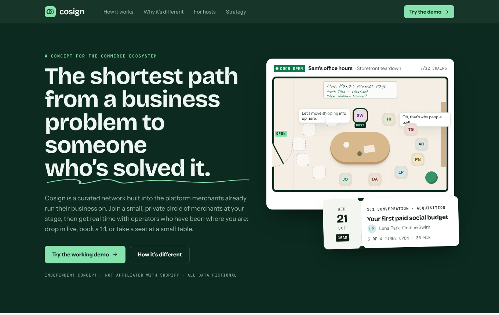
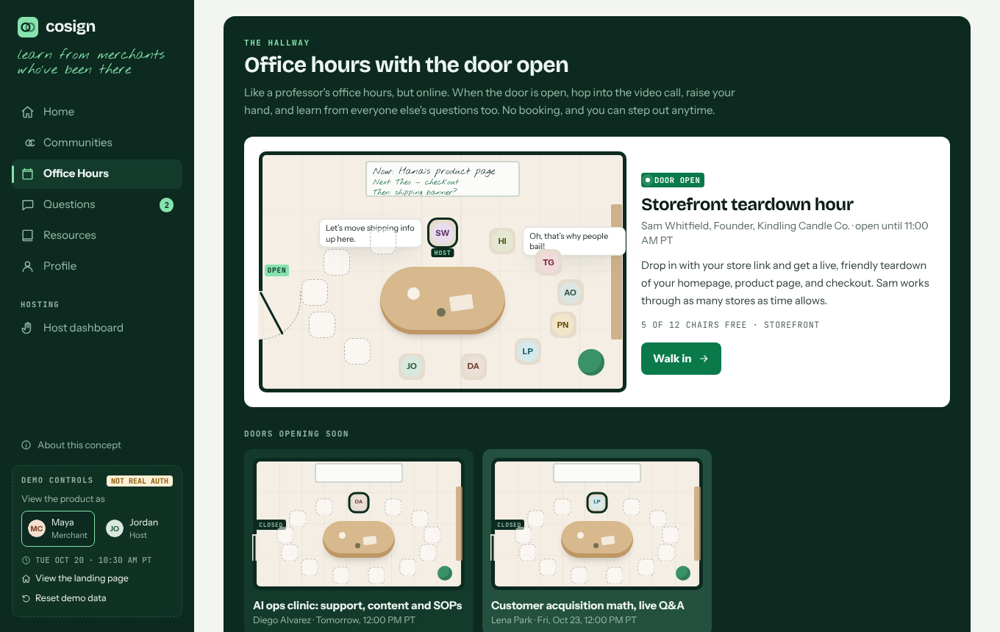
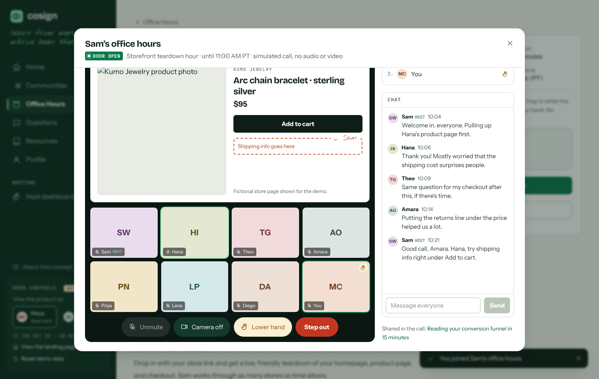
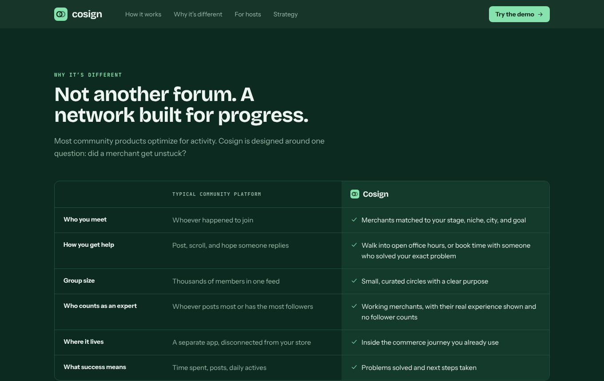
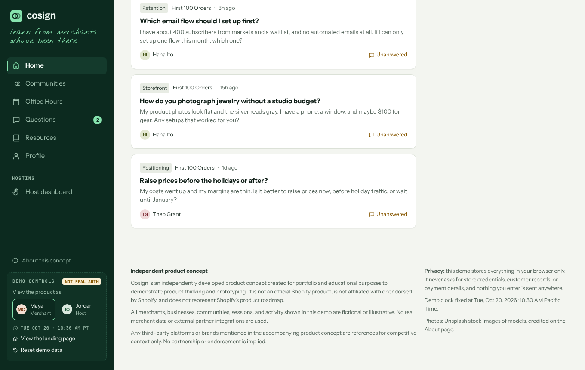

# Cosign

**The shortest path from a business problem to someone who's solved it.**

### [▶ Try the live demo](https://nweinberg97.github.io/Cosign/)

Cosign is an independent product concept and working prototype: a curated network built into the commerce platform merchants already use. Merchants join small, private circles matched to their stage, niche, and city, and get time with experienced operators through **Office Hours**: walk into open-door drop-in hours, book a private 1:1, or take a seat at a small table.



### Office Hours that feel like office hours

Like a professor's office hours, online. Browse a hallway of offices to see whose door is open, then hop into the video call, raise your hand, and chat. The host can share their screen to work through someone's store live.





### Not another forum





> **Independent product concept.** Cosign is an independently developed product concept created for portfolio and educational purposes to demonstrate product thinking and prototyping. It is not an official Shopify product, is not affiliated with or endorsed by Shopify, and does not represent Shopify's product roadmap. All merchants, businesses, communities, sessions, and activity shown in this demo are fictional or illustrative. No real merchant data or external partner integrations are used.

## Run it

```bash
npm install
npm run dev        # http://localhost:3000
```

Other scripts: `npm run build`, `npm run start`, `npm run lint`, `npm run typecheck`.

No environment variables, accounts, or services are needed. Everything runs in the browser.

## What to try (about 5 minutes)

The app opens on a landing page that explains the concept, how it differs from typical community platforms, and the strategy behind it. You can return to it anytime from **Demo controls → View the landing page**.

1. **Enter as Maya**, a newer skincare merchant, and personalize (stage, goal, topics). Home re-ranks around your answers and explains every recommendation.
2. **Join a community** (e.g. Vancouver Consumer Brands). Members and discussions unlock — membership is private by design.
3. **Office Hours** → Sam's door is open: join the call, raise your hand, and send a chat message. Then open *Conversion quick wins for new stores* → **Reserve a seat**; it appears on Home and in **My bookings**.
4. Book a **1:1** by picking a time slot, and try the **fully booked** pricing session.
5. **Questions** → ask something, reply, mark an answer helpful, and jump from the question to relevant Office Hours.
6. In **Demo controls** (sidebar, or *More* on mobile) **switch to Jordan**, the host. Review attendees and advance questions, then **Offer Office Hours** and see it in discovery immediately.
7. Edit your **profile** and add a link. Refresh — everything persists. **Reset demo data** restores the seed.

## Product decisions

- **Office Hours is the center of gravity.** Communities provide context; questions route to people. Every surface ends in a next step rather than a feed.
- **Explainable, deterministic matching.** Recommendations are simple rules over stated context (stage, location, goal, topics), each with a visible reason. No AI, no hidden signals.
- **Trust over openness.** Discussions and member directories are visible only to members; hosts' advice is framed as experience, not guarantees.
- **Progress over engagement.** Past sessions ask "Was this useful?" and "What will you do next?" There is intentionally no vanity analytics dashboard.
- **Honest simulation.** Persona switching, drop-in rooms, bookings, and member counts are clearly labeled as simulated. Nothing claims to send an email or invite.

## Trade-offs and assumptions

- **Fixed demo clock** — Tue, Oct 20, 2026, 10:30 AM Pacific — so live/upcoming/full states are always explorable. All times are shown in PT.
- **Curated, read-only communities** — no community creation, by design.
- **Anyone can host.** Maya can offer a session too (reciprocity), and creating one makes her a host.
- **Client-rendered app.** State is browser-local, so pages render after hydration with a brief loading state. A production version would server-render with real data.
- **No icon or UI dependencies.** A small in-repo icon set and components keep the bundle lean.
- **Stock photography.** Headshots and product photos are Unsplash images of models (credited on the About page), loaded from Unsplash's CDN with initials as the fallback. The README screenshots were captured offline, so they show the initials.

## The live demo (GitHub Pages)

`docs/index.html` is a prebuilt, single-file static preview of this app, served by GitHub Pages from the `docs/` folder. It runs the same source as the Next.js app; page changes happen in-app, so the browser address bar stays on the home URL.

## Architecture

```
src/
  app/                 Next.js App Router routes (thin wrappers)
  components/
    shell/             App shell, navigation, onboarding, welcome, disclosure
    views/             One view per page (Home, Office Hours, Communities, ...)
    cards/             Session, community, expert, question, resource cards
    booking/           Booking panel, slot picker, simulated drop-in room, feedback
    ui/                Buttons, dialogs, fields, toasts, layout primitives, icons
  lib/
    types.ts           Typed domain model
    seed.ts            Deterministic fictional seed data
    store.tsx          External store (useSyncExternalStore) + validated domain actions
    storage.ts         localStorage persistence with in-memory fallback and validation
    selectors.ts       Derived state (capacity, phases, bookings, ...)
    recommend.ts       Explainable matching rules
    time.ts            Pacific Time formatting and conversion
```

Every domain action (join, book, cancel, ask, reply, vote, create/edit/cancel session, edit profile) validates input and returns a result, so the UI only confirms things that actually happened. Duplicate bookings, over-capacity bookings, joining drop-ins that aren't live, and removing booked slots are all prevented.

## Accessibility

Semantic landmarks and headings, skip link, visible focus states, native `<dialog>` modals (focus trap, Escape, focus return), labeled form fields with linked error messages, `aria-pressed` on toggles, live-region toasts, status shown with text and icons (not color alone), and reduced-motion support.

## Verification notes

The build environment used to write this project could not reach the npm registry, so `npm install`, `next build`, and `next lint` were not run there. Instead:

- The full source was type-checked with TypeScript in strict mode (plus unused-locals/parameters checks) against local type shims for React and Next.js.
- The app was bundled with esbuild and Tailwind CSS v4's compiler, and all 18 "definition of done" journeys — including persistence across reload, malformed-storage recovery, reset, and mobile layouts with no horizontal overflow — were exercised end-to-end in headless Chromium with zero console errors.

Run `npm run typecheck`, `npm run lint`, and `npm run build` after installing to confirm against the real Next.js toolchain.
